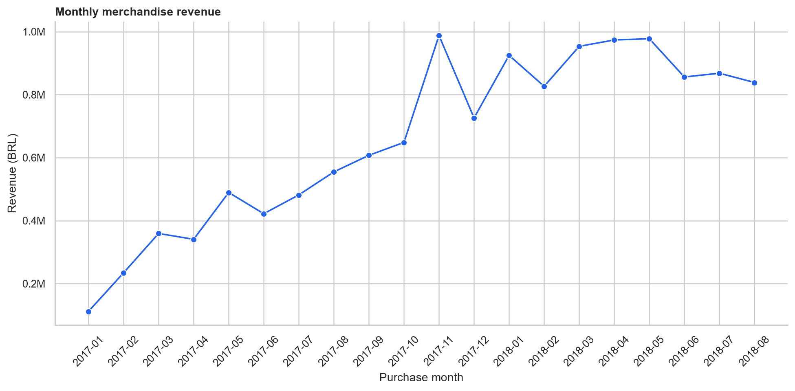
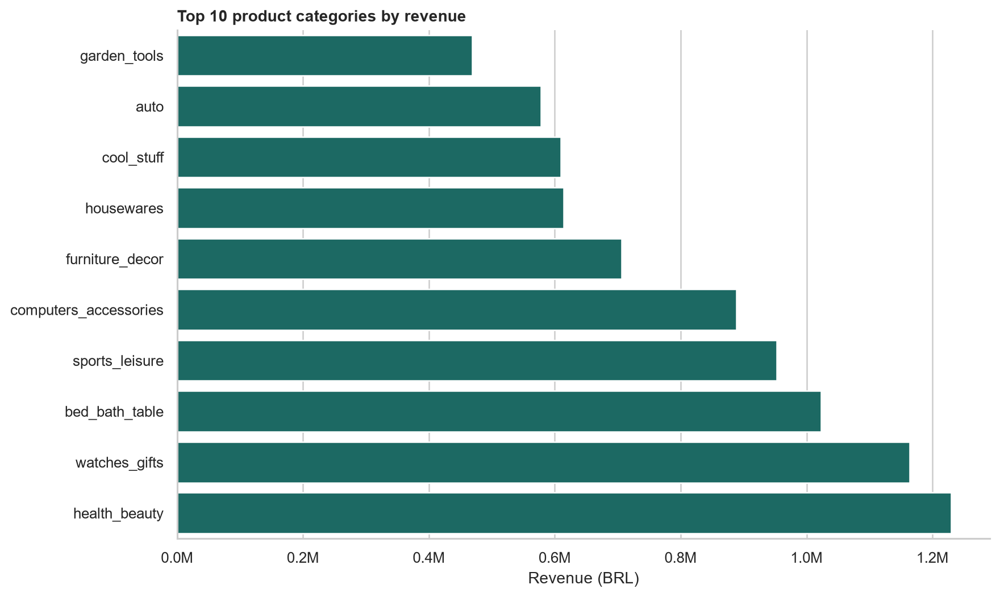
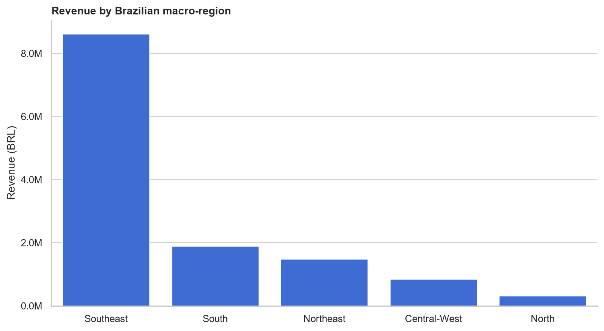

# Olist E-Commerce Sales Analysis

Учебный аналитический проект по продажам бразильского маркетплейса Olist. Проект показывает полный цикл работы Junior Data Analyst: загрузку и проверку данных, объединение таблиц, расчёт метрик в Python и SQL, визуализацию, интерпретацию результатов и воспроизводимую структуру репозитория.

**Краткое описание для GitHub:** End-to-end analysis of 96K delivered Olist orders using Python, pandas, SQL and reproducible visualizations.

## Цель и вопросы анализа

Цель — определить динамику продаж, ведущие категории и регионы, наиболее продаваемые товары и долю повторных покупателей.

Основные вопросы:

- Какова товарная выручка, количество заказов и средний чек?
- Как менялась выручка по месяцам?
- Какие категории и товары обеспечили наибольший объём продаж?
- Как распределяется выручка между макрорегионами Бразилии?
- Какая доля клиентов совершила больше одного заказа?

## Основные результаты

Расчёты относятся к доставленным заказам с января 2017 года по август 2018 года. Выручка определена как сумма цен товаров без стоимости доставки.

| Показатель | Результат |
|---|---:|
| Товарная выручка | 13 181 027,13 BRL |
| Доставленные заказы | 96 211 |
| Проданные товарные позиции | 109 880 |
| Средний чек | 137,00 BRL |
| Уникальные покупатели | 93 104 |
| Повторные покупатели | 2 789 |
| Доля повторных покупателей | 3,00% |

## Ключевые выводы

1. Выручка за январь–август 2018 года была на 141,1% выше, чем за те же месяцы 2017 года. Это наблюдаемая динамика выборки, а не доказательство причины роста.
2. Максимальная месячная выручка зафиксирована в ноябре 2017 года — 987,8 тыс. BRL. В декабре она снизилась на 26,5%.
3. Пять ведущих категорий обеспечили 39,9% выручки. Наибольшая доля принадлежит категории `health_beauty` — 9,3%.
4. На Southeast пришлось 65,4% выручки. Доля North составила 2,5%, что показывает сильную географическую концентрацию.
5. Повторную покупку совершили только 3,0% уникальных клиентов внутри выбранного периода.
6. В наборе найдено 8 130 товарных строк выше верхней границы IQR по цене. Они отмечены, но не удалены: высокая цена не является достаточным доказательством ошибки.

## Рекомендации

- Проверить сценарии второй покупки: послепродажные сообщения, персональные предложения и сроки повторного заказа.
- Учитывать концентрацию выручки в ведущих категориях при планировании запасов и продвижения, одновременно контролируя зависимость от них.
- Отдельно исследовать ноябрьский пик и декабрьское снижение перед сезонным планированием. Текущие данные не подтверждают причину изменения.
- Тестировать региональные предложения за пределами Southeast и дополнить анализ стоимостью доставки и маржинальностью.
- Проверять дорогие позиции по категории, продавцу и исходной записи до решения об исключении выбросов.

## Визуализации

### Динамика товарной выручки



### Категории с наибольшей выручкой



### Распределение выручки по регионам



## Проверка качества данных

| Проверка | Результат | Решение |
|---|---:|---|
| Полные дубликаты в используемых исходных таблицах | 0 | Проверка выполнена до объединений |
| Отрицательная цена или стоимость доставки | 0 | Правило исключения сохранено в коде |
| Заказы со статусом, отличным от `delivered` | 2 963 | Исключены из реализованных продаж |
| Доставленные заказы вне полного периода анализа | 267 | Исключены для сопоставимости месяцев |
| Товарные строки без переведённой категории | 1 557 | Сохранены с категорией `unknown` |
| Товарные строки без определённого макрорегиона | 0 | Проверено после объединения |
| Ценовые выбросы по правилу IQR | 8 130 | Сохранены и явно отмечены |

## SQL

Файл [`sql/analysis.sql`](sql/analysis.sql) содержит восемь проверенных запросов SQLite:

1. общая выручка, число заказов и средний чек;
2. помесячная динамика;
3. категории по выручке;
4. продажи по макрорегионам;
5. наиболее продаваемые товары;
6. доля повторных покупателей;
7. изменение выручки месяц к месяцу с `LAG`;
8. ведущая категория каждого региона с `DENSE_RANK`.

Запросы используют `JOIN`, агрегирование, `CASE`, CTE и оконные функции. Их результаты сверены с расчётами Python.

## Данные

Источник: [Brazilian E-Commerce Public Dataset by Olist](https://www.kaggle.com/datasets/olistbr/brazilian-ecommerce).

Это реальные анонимизированные коммерческие данные примерно о 100 тысячах заказов 2016–2018 годов. Лицензия набора данных — CC BY-NC-SA 4.0. Код проекта распространяется по лицензии MIT; исходный набор данных под MIT не переоформляется.

Исходные CSV не хранятся в репозитории из-за размера. Скрипт загрузки получает их напрямую через открытый Kaggle API. В репозитории находятся компактные итоговые таблицы и выборка из 1 000 очищенных строк. Полная аналитическая витрина создаётся локально.

## Как воспроизвести проект

Команды выполняются из корня репозитория.

```powershell
python -m venv .venv
.venv\Scripts\Activate.ps1
python -m pip install -r requirements.txt
python scripts/download_data.py
python -m src.analysis
python scripts/load_sqlite.py
python scripts/run_sql_queries.py
python -m unittest discover -s tests -v
jupyter notebook notebooks/analysis.ipynb
```

Если исходные данные уже загружены, скрипт загрузки не скачивает их повторно. Для принудительного обновления используется `python scripts/download_data.py --force`.

## Структура репозитория

```text
.
├── data/
│   ├── raw/                 # инструкция; исходные CSV исключены из Git
│   └── processed/           # метрики, агрегаты и пример очищенных строк
├── images/                  # графики для README
├── notebooks/
│   └── analysis.ipynb       # выполненный анализ с выводами
├── scripts/
│   ├── build_notebook.py
│   ├── download_data.py
│   ├── load_sqlite.py
│   └── run_sql_queries.py
├── sql/
│   └── analysis.sql
├── src/
│   └── analysis.py          # очистка, расчёты и визуализация
├── tests/
│   └── test_analysis.py
├── .gitignore
├── LICENSE
├── README.md
└── requirements.txt
```

## Предлагаемая история коммитов

1. `chore: initialize analytics project structure`
2. `feat: add reproducible Olist data download`
3. `feat: build sales cleaning and metrics pipeline`
4. `feat: add SQLite schema loader and business queries`
5. `feat: add executed notebook and visualizations`
6. `docs: document findings, limitations and setup`

## Публикация на GitHub

После создания пустого публичного репозитория `olist-ecommerce-sales-analysis`:

```powershell
git branch -M main
git add .
git commit -m "feat: publish Olist e-commerce sales analysis"
git remote add origin https://github.com/USERNAME/olist-ecommerce-sales-analysis.git
git push -u origin main
```

Перед командой `git commit` следует настроить имя и адрес автора Git, если они ещё не заданы. `USERNAME` нужно заменить на имя пользователя GitHub.

## Ограничения

- В данных отсутствует себестоимость, поэтому проект анализирует выручку, а не прибыль.
- Стоимость доставки не включена в показатель товарной выручки.
- Набор относится к Бразилии и историческому периоду 2016–2018 годов.
- Товарные названия отсутствуют; продукты представлены анонимизированными идентификаторами.
- Наблюдаемые связи не подтверждают причинно-следственные зависимости.

